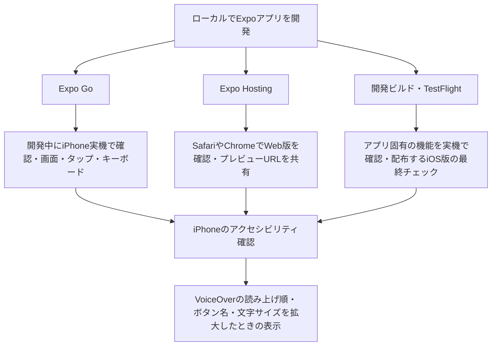

# Welcome to your Expo app 👋

This is an [Expo](https://expo.dev) project created with [`create-expo-app`](https://www.npmjs.com/package/create-expo-app).

## Get started

1. Install dependencies

   ```bash
   npm install
   ```

2. Start the app

   ```bash
   npx expo start
   ```

In the output, you'll find options to open the app in a

- [development build](https://docs.expo.dev/develop/development-builds/introduction/)
- [Android emulator](https://docs.expo.dev/workflow/android-studio-emulator/)
- [iOS simulator](https://docs.expo.dev/workflow/ios-simulator/)
- [Expo Go](https://expo.dev/go), a limited sandbox for trying out app development with Expo

You can start developing by editing the files inside the **src/app** directory. This project uses [file-based routing](https://docs.expo.dev/router/introduction).

## 開発中の実機確認と Web 版の使い分け




このプロジェクトは iOS・Android 向けの Expo アプリで、Safari や Chrome でも Web 版を確認できます。

| 確認環境 | 用途 |
| --- | --- |
| [Expo Go](https://expo.dev/go) | 開発中に iPhone 実機で画面、タップ操作、キーボード、アクセシビリティをこまめに確認する |
| Expo Hosting | Web 版を Safari や Chrome で確認し、プレビュー URL を共有する |
| [開発ビルド](https://docs.expo.dev/develop/development-builds/introduction/) | Expo Go に含まれないネイティブ機能やアプリ固有の設定を実機で確認する |
| [TestFlight](https://docs.expo.dev/tutorial/eas/ios-production-build/) | 配布する iOS ビルドで最終確認する |

開発中は、プロジェクトのルートで `npx expo start` を実行し、ターミナルに表示された QR コードを iPhone で読み取って Expo Go で開きます。ソースの変更を実機で確認するたびに Expo Hosting へ公開する必要はありません。

### iPhone でアクセシビリティを確認する

- VoiceOver をオンにして、読み上げ順、ボタン名、フォーカスの移動を確認します。
- iOS の文字サイズを大きくし、文字切れやボタンの重なりがないか確認します。
- Web 版も公開する場合は、iPhone の Safari でも同じ項目を確認します。ブラウザの表示領域、スクロール、キーボード、読み上げやフォーカスの動きは、ネイティブ版と異なる場合があります。

Expo Workflows の自動公開は Web 版に適用されます。iOS 版を配布する前は、TestFlight でアクセシビリティと主要な操作を確認します。

## Expo Hosting に Web プレビューをデプロイする

このリポジトリの Web 版は、[Expo の `@masa-practice/expo-app-to-deploy` プロジェクト](https://expo.dev/accounts/masa-practice/projects/expo-app-to-deploy)に紐づいています。以下の手順で、ローカルのコードを Safari や Chrome で確認できるプレビュー URL に公開できます。

### 1. 依存関係をインストールして Expo にログインする

リポジトリのルートで実行します。

```bash
npm ci
npx eas-cli@latest login
npx eas-cli@latest whoami
npx eas-cli@latest project:info
```

`project:info` に `@masa-practice/expo-app-to-deploy` が表示されることを確認します。このリポジトリの [app.json](app.json) には `expo.owner` と `expo.extra.eas.projectId` が設定済みです。

初回のセットアップなどで `EAS project not configured` が表示された場合は、Expo ダッシュボードで対象プロジェクトの Project ID を確認し、既存のプロジェクトに紐づけます。

```bash
npx eas-cli@latest init --id 200513de-0587-41c5-bf74-dbad4d538415 --non-interactive
npx eas-cli@latest project:info
```

#### Expo にまだ登録していない新しいアプリの場合

新しいアプリ自身のプロジェクトルートで依存関係をインストールし、Expo にログインします。アプリ設定（`app.json` など）の `expo.slug` に新しいアプリのスラッグ、`expo.owner` に `masa-practice` を設定します。

```bash
npx eas-cli@latest init --account masa-practice --non-interactive
npx eas-cli@latest project:info
```

初期化によって EAS プロジェクトが作成され、ローカルのアプリに紐づきます。`project:info` に `@masa-practice/新しいアプリのスラッグ` が表示されることを確認します。このリポジトリをひな形に使う場合は、初期化前にアプリ設定からコピー元の `expo.extra.eas.projectId` を削除してください。

Web プレビューを公開するには、新しいアプリの `expo.web.output` を `static` または `server` に設定し、次の手順に進みます。

### 2. Web 版を出力してプレビューを公開する

```bash
npx expo export --platform web
npx eas-cli@latest deploy
```

最初のコマンドで Web 版を `dist/` に出力し、次のコマンドで Expo Hosting に公開します。初回にプレビュー用のサブドメインを求められたら選択します。

完了後は、ターミナルに表示されるプレビュー URL を Safari や Chrome で開きます。このプロジェクトの例は [https://expo-app-to-deploy--iyy4d934e6.expo.app/](https://expo-app-to-deploy--iyy4d934e6.expo.app/) です。末尾の `--iyy4d934e6` はデプロイ ID で、次回のデプロイでは別の URL が発行されます。

### 3. 固定の本番 URL に公開する

プレビューで動作を確認したら、同じソースから Web 版を出力し、本番に公開します。

```bash
npx expo export --platform web
npx eas-cli@latest deploy --prod
```

このプロジェクトの本番 URL は [https://expo-app-to-deploy.expo.app/](https://expo-app-to-deploy.expo.app/) です。本番デプロイを実行するたびに、同じ URL に新しいバージョンが反映されます。

ソースを変更して GitHub に `git push` した後は、変更が入っているローカルのプロジェクトルートで Web 版を再出力し、公開先に応じて `deploy` または `deploy --prod` を実行します。この手順は手動で公開する場合に使います。GitHub に push してから自動で公開する手順は次のセクションを参照してください。デプロイ履歴は [Expo ダッシュボードの対象プロジェクト](https://expo.dev/accounts/masa-practice/projects/expo-app-to-deploy) の Hosting で確認できます。

iPhone にインストールするネイティブ版のビルドには [EAS Build](https://docs.expo.dev/build/setup/) を使います。

[Expo 公式の Web デプロイ手順](https://docs.expo.dev/deploy/web/) · [プレビューと本番の URL](https://docs.expo.dev/eas/hosting/deployments-and-aliases/)

## GitHub 連携で Web 版を自動デプロイする

### 初回セットアップ

1. [Expo プロジェクト](https://expo.dev/accounts/masa-practice/projects/expo-app-to-deploy) の **GitHub settings** を開き、画面の案内に沿って Expo の GitHub App を設定し、`iwasaki-hub/expo-app-to-deploy` を接続します。
2. `app.json` と `package.json` はリポジトリのルートにあるため、**Base directory** は空欄にします。
3. リポジトリのルートにある `.eas/workflows/` の YAML を使います。**Get started** で表示される `eas build --platform all` は iOS / Android のネイティブビルド用です。Web 自動デプロイの設定は以下の YAML で行います。

| 設定ファイル | 実行条件 | 公開先 |
| --- | --- | --- |
| [pr-preview.yml](.eas/workflows/pr-preview.yml) | PR の作成・再オープン・更新 | デプロイごとのプレビュー URL |
| [deploy-production.yml](.eas/workflows/deploy-production.yml) | `main` への push（PR のマージを含む） | [固定の本番 URL](https://expo-app-to-deploy.expo.app/) |

### 変更を公開する

1. 作業ブランチに変更を push して PR を作成します。PR に追加のコミットを push すると、新しいプレビューが作られます。
2. Expo ダッシュボードの **Workflows** で **Web Preview** の実行状況を確認し、成功後に **Hosting** で発行されたプレビュー URL を開きます。
3. PR を `main` にマージすると **Web Production** が起動します。成功後に固定の本番 URL で反映を確認します。

Expo Workflows が Web 版の出力とデプロイを実行するため、この流れではローカルで `npx expo export --platform web` や `npx eas-cli@latest deploy` を実行する必要はありません。実行中は **Workflows** で完了を待ち、失敗時は対象ジョブのログを確認します。現在の設定では README のみの変更でも PR と `main` への反映がそれぞれデプロイを起動します。

### 無料枠の実行待ちと手動プレビュー

ログに `Waiting to start` と `waiting in the Free Tier queue` が表示されている間は、Expo のクラウド実行枠が空くのを待っています。このリポジトリの初回実行では、キューに入った時点で約 35.5 分の待ち時間が表示されました。これはその時点の目安で、待ち時間は混雑状況によって変わります。

PR に短時間で何度も push すると、更新ごとのプレビューが実行待ちになり、成功したデプロイごとに URL が発行されます。すぐに Web 版を確認したいときは、プロジェクトのルートで次を実行します。

```bash
npx expo export --platform web
npx eas-cli@latest deploy
```

手動では自分の PC で Web 版を出力し、その結果を Expo Hosting にアップロードするため、Expo Workflows の実行待ちを経ずにプレビューを公開できます。表示されたプレビュー URL を Safari や Chrome で開いて確認します。

プレビューを必要なときだけ手動で公開し、本番だけ自動化する運用に変更する場合は、`pr-preview.yml` を削除し、`deploy-production.yml` を残します。本番の自動デプロイには引き続きクラウドの実行待ちが発生することがあります。

[Expo 公式の Workflows による Web デプロイ手順](https://docs.expo.dev/eas/hosting/workflows/)

## Get a fresh project

When you're ready, run:

```bash
npm run reset-project
```

This command will move the starter code to the **example** directory and create a blank **src/app** directory where you can start developing.

### Other setup steps

- To set up ESLint for linting, run `npx expo lint`, or follow our guide on ["Using ESLint and Prettier"](https://docs.expo.dev/guides/using-eslint/)
- If you'd like to set up unit testing, follow our guide on ["Unit Testing with Jest"](https://docs.expo.dev/develop/unit-testing/)
- Learn more about the TypeScript setup in this template in our guide on ["Using TypeScript"](https://docs.expo.dev/guides/typescript/)

## Learn more

To learn more about developing your project with Expo, look at the following resources:

- [Expo documentation](https://docs.expo.dev/): Learn fundamentals, or go into advanced topics with our [guides](https://docs.expo.dev/guides).
- [Learn Expo tutorial](https://docs.expo.dev/tutorial/introduction/): Follow a step-by-step tutorial where you'll create a project that runs on Android, iOS, and the web.

## Join the community

Join our community of developers creating universal apps.

- [Expo on GitHub](https://github.com/expo/expo): View our open source platform and contribute.
- [Discord community](https://chat.expo.dev): Chat with Expo users and ask questions.
